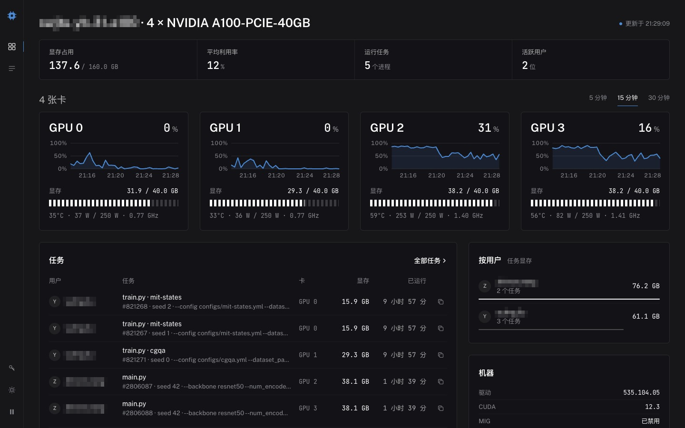

# GPU 监控

一个本地运行的 GPU 监控面板：通过 SSH 连接 Linux 服务器，每 2 秒读取一次 `nvidia-smi`，不用登录机器就能看清显卡负载、显存余量和正在跑的任务。



## 功能

一屏看清整台机器：顶部是显存、利用率、任务和用户的整体指标；下方每张显卡一张卡片，曲线、显存、温度和功耗一眼可见，点卡片还能查看这张卡上的任务。页面下半部分是运行中的任务、按用户汇总的显存占用和机器信息；任务页平铺全部进程与完整命令行，并可按显卡筛选。侧栏可随时暂停刷新或切换深浅主题。

## 桌面版

- **macOS**：解压 `GPU-Monitor-Electron-macos-arm64.zip`，双击 `GPU Monitor.app`。这个包适用于 Apple Silicon。可将应用拖到「应用程序」目录。
- **Windows x64**：下载 `GPU-Monitor-Setup-<版本>-x64.exe`，双击并按向导安装。也可下载便携 ZIP，完整解压后运行 `GPU Monitor.exe`。使用免密登录时，请在 Windows 的可选功能中安装 OpenSSH 客户端。
- **从源码启动**：安装 Node.js 22.12 或以上版本，在 macOS 双击 `gpu-monitor.command`。也可以运行 `npm ci && npm start`。首次启动会下载 Electron 运行时。
- **开发调试**：运行 `npm run dev`。改 `public/` 下的页面文件会自动刷新窗口，改 `desktop.mjs`、`server.mjs` 等主进程文件会自动重启应用，DevTools 默认以独立窗口打开。设置 `GPU_MONITOR_DEV=0` 可关闭 DevTools。

关闭窗口后仍会继续采样。用 macOS 菜单栏或 Windows 托盘的「打开面板」恢复窗口，也可以再次双击应用。要结束采样，从同一菜单选择「退出」。

带有更新功能的 macOS 发行版会在启动后自动检查新版，也可以从「GPU Monitor」菜单或菜单栏图标选择「检查更新…」。发现新版时会显示更新说明，由你确认是否安装。从未内置更新器的版本升级时，第一次需要手动安装带更新器的版本。

Windows 安装版在启动时自动检查更新，也可以从窗口的「帮助」菜单或托盘菜单选择「检查更新…」。确认后应用会下载新版，并重启完成安装。便携版用户可以先退出旧版，再运行安装包启用此功能，原有的连接和采样历史会继续使用。

## 连接和迁移

第一次打开时可选择 SSH 配置里的免密主机，也可输入主机、端口、用户名和密码。登录后会保存连接并在下次启动时重连。密码由 macOS 钥匙串或 Windows DPAPI 保存。点「清除登录」可断开并删除保存的连接。

- **从旧发行版升级**：先从菜单栏或托盘退出旧版，再启动 Electron，避免同时写入同一份历史。macOS 继续使用 `~/Library/Application Support/GPU Monitor` 和原钥匙串条目。Windows 继续使用 `%LOCALAPPDATA%\GPU Monitor`，同一个 Windows 账户可解密原密码。
- **从源码网页版迁移**：桌面数据目录为空时，先从原项目启动一次 Electron。应用会复制项目 `data/` 中的连接和采样历史。以后启动发行版会继续使用同一平台目录。
- **指定目录**：可用 `GPU_MONITOR_DATA_DIR` 指定存储目录。默认情况下，网页版与桌面版各用自己的目录。请为同时运行的实例使用不同目录。

## 微信通知

侧栏的「通知」可以蹲 GPU 余量：设定需要几块卡、每块至少多少 GB 可用显存，当前服务器 5 分钟内至少 90% 的采样满足条件后，推一条通知，然后这次蹲守自动结束。通知只在当前服务器上生效；换服务器会重新累计 5 分钟，但不会取消蹲守。

支持两个通道。填写了哪个就推哪个；两个都填写时同时推送，任一通道成功即结束本次蹲守：

- **Server酱**：在 [Server酱](https://sct.ftqq.com/sendkey) 微信扫码登录后获取 `SendKey`，消息直接进微信，不用安装新 app。免费额度每天 5 条，对本功能足够。
- **WxPusher**：打开 [WxPusher 极简推送](https://wxpusher.zjiecode.com/docs/#/?id=spt) 扫码获取以 `SPT_` 开头的令牌。它的接入方式和客户端要求可能变化，以官方文档为准。

两个凭据都以明文保存在本机数据目录的 `notify.json`（Unix 下权限 0600；Windows 依赖用户目录 ACL），不会上传到对应服务以外的地方。

- **判定口径**：一张卡利用率不高于「利用率上限」（默认 10%）、可用显存不低于设定值，才算一块可用 GPU。显存阈值填 0 时只看利用率，显存占满但空转的卡也会算进去；蹲模型请填真实需求值。
- **推送失败**：会自动重试 3 次，仍失败时桌面版弹系统通知，蹲守保留，60 秒后再试。macOS 需要在系统设置里允许 GPU Monitor 发送通知；网页版只在面板显示结果。
- **前提**：应用必须保持运行。关闭窗口仍会继续采样，「退出」或电脑睡眠期间不会推送。同一时刻只监控一台服务器。MIG 模式下显存统计口径可能不直观。
- **升级**：从源码网页版迁移到桌面版时，连接和采样历史会复制过去，`notify.json` 不会，需要重新填写一次凭据。

## 网页版

```bash
npm ci --omit=dev
node server.mjs
```

在浏览器访问 <http://127.0.0.1:8787>。默认在项目的 `data/` 保存数据。仍可通过环境变量调整端口、监听地址和初始连接，例如 `SSH_HOST=my-gpu-box PORT=9000 HOST=127.0.0.1 node server.mjs`。

## 构建发行版

在 macOS 使用 Node.js 22.12 或以上版本。两个 ZIP 都包含 Electron 运行时和应用依赖。

```bash
npm ci
packaging/build-macos.sh       # 当前 Mac 架构，也可显式传入 arm64 或 x64
packaging/build-windows.sh     # Windows x64
```

构建产物输出到 `dist/`。macOS 脚本生成 ad-hoc 签名包，无 Developer ID 签名或公证。Windows 脚本生成 NSIS 安装包、更新清单和便携 ZIP。未配置 Authenticode 证书时，Windows 可能显示 SmartScreen 提示。

发布新版时，请按 [发布指南](docs/README-release.md) 更新版本号、签署更新清单并核对 GitHub Release。

## 常见问题

- **网页版端口已占用**：退出占用 8787 的服务，或用 `PORT` 指定其他端口。
- **免密登录失败**：先在终端确认 `ssh <别名> nvidia-smi` 能直接运行。
- **密码登录提示主机指纹变化**：向管理员核实新指纹后，勾选「信任新的主机指纹并继续」。
- **一直显示「正在连接…」**：检查网络、SSH 和远端的 `nvidia-smi`。如果显示「未选择服务器」，请在左侧栏点「登录」。
